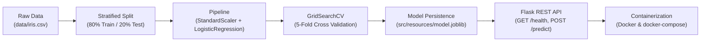

# 🌸 Iris Flower Classification

[](https://www.python.org/)
[](https://scikit-learn.org/)
[](https://flask.palletsprojects.com/)
[](https://docs.pytest.org/)
[](https://www.docker.com/)
[](https://peps.python.org/pep-0008/)
[](LICENSE)

> **A production-ready, end-to-end Machine Learning pipeline and REST API for Iris flower classification, designed according to software engineering and MLOps best practices (From Notebook Experiments to Containerized Deployment).**

---

## 📑 Table of Contents

- [Pipeline Overview](#-pipeline-overview)
- [Key Engineering Features](#-key-engineering-features)
- [Project Architecture](#-project-architecture)
- [Quick Start](#-quick-start)
  - [1. Environment Setup](#1-environment-setup)
  - [2. Model Training & Evaluation](#2-model-training--evaluation)
  - [3. Automated Testing](#3-automated-testing)
  - [4. Launch API Server](#4-launch-api-server)
- [REST API Reference](#-rest-api-reference)
  - [Health Check (`GET /health`)](#1-health-check)
  - [Prediction Endpoint (`POST /predict`)](#2-prediction-endpoint)
  - [Client Code Examples](#3-client-code-examples)
- [Docker Deployment](#-docker-deployment)
- [Model Evaluation & Results](#-model-evaluation--results)
- [Author & Acknowledgments](#-author--acknowledgments)

---

## 🔄 Pipeline Overview

The project demonstrates how to structure an ML workflow into modular, reusable, and testable components:



---

## 🌟 Key Engineering Features

| Category | Implementation & Best Practice |
|:---|:---|
| **Decoupled Config** | Hyperparameters, cross-validation folds, scoring metrics, and file paths are fully centralized in `src/conf/design.json` and accessed via `config.py` — eliminating hardcoded magic values. |
| **Clean Code Style** | Strict adherence to PEP 8 standards, comprehensive documentation, and Python Type Hints across all modules and functions. |
| **Enterprise Logging** | Replaces arbitrary `print()` statements with Python's standard `logging` module, capturing timestamps, log levels, file names, function names, and line numbers into `logs.log`. |
| **Reproducible Pipeline** | Leverages `scikit-learn.pipeline.Pipeline` with `StandardScaler` and `LogisticRegression` to prevent data leakage during preprocessing and inference. |
| **Model Serialization** | Production-grade serialization with `joblib` allowing instantaneous deserialization and low-latency inference. |
| **Automated Testing** | Pytest test suite covering data integrity, model performance thresholds, and Flask REST endpoints. |
| **Containerization** | Production-ready `Dockerfile` and `docker-compose.yml` that run test validations during build time. |

---

## 🏗️ Project Architecture

```text
iris_classification_project/
├── .gitignore               # Excludes virtual environments, pycache, and logs
├── README.md                # Comprehensive project documentation
├── requirements.txt         # Explicit Python dependencies
├── Dockerfile               # Production multi-stage Docker build
├── docker-compose.yml       # One-command container orchestration
├── run.py                   # Entry point for local pipeline execution & validation
├── run_app.py               # Entry point for the Flask REST API server
├── logs.log                 # Generated application runtime log file
│
├── data/                    # Dataset directory
│   └── iris.csv             # Cleaned & structured Iris dataset
│
├── src/
│   ├── conf/                # Configuration management
│   │   ├── design.json      # Hyperparameters, CV folds, and system paths
│   │   └── config.py        # Config loader module with get_default()
│   │
│   ├── utils/               # Utility modules
│   │   └── logger.py        # Centralized logger configuration
│   │
│   ├── main/                # Core Machine Learning logic
│   │   ├── data_loader.py   # Dataset acquisition and caching
│   │   ├── preprocessing.py # Stratified train-test splitting
│   │   ├── train.py         # Pipeline builder, GridSearchCV & joblib export
│   │   └── predict.py       # Inference engine & class confidence calculator
│   │
│   ├── resources/           # Serialized models and artifacts
│   │   └── model.joblib     # Exported scikit-learn pipeline
│   │
│   └── template_app/        # Web deployment layer
│       └── app.py           # Flask REST API endpoints and request handlers
│
└── tests/                   # Automated Pytest suite
    ├── test_data.py         # Data validation & split tests
    ├── test_model.py        # Model accuracy & persistence tests
    └── test_app.py          # Flask HTTP endpoints & error handling tests
```

---

## 🚀 Quick Start

### 1. Environment Setup

Clone the repository and set up a clean Python virtual environment:

```bash
# Clone the repository
git clone https://github.com/MariamMoubarak55/iris-flower-classification.git
cd iris-flower-classification

# Create virtual environment
python -m venv venv

# Activate virtual environment
# Windows PowerShell:
.\venv\Scripts\Activate.ps1
# Linux / macOS:
source venv/bin/activate

# Install required dependencies
pip install -r requirements.txt
```

---

### 2. Model Training & Evaluation

To execute the entire training pipeline, run:

```bash
python run.py
```

**What this executes:**
1. Loads/caches the Iris dataset into `data/iris.csv`.
2. Splits features into stratified training and testing sets.
3. Tunes hyperparameters using 5-fold `GridSearchCV`.
4. Evaluates accuracy and logs a classification report.
5. Serializes the fitted pipeline to `src/resources/model.joblib`.
6. Executes sample inference to verify model integrity.

---

### 3. Automated Testing

Run the full automated test suite using `pytest`:

```bash
pytest -v
```

**Test Results:**
```text
tests/test_app.py::test_home_endpoint PASSED                      [ 10%]
tests/test_app.py::test_health_endpoint PASSED                    [ 20%]
tests/test_app.py::test_predict_endpoint_success PASSED           [ 30%]
tests/test_app.py::test_predict_endpoint_dict_format PASSED       [ 40%]
tests/test_app.py::test_predict_endpoint_bad_request PASSED       [ 50%]
tests/test_data.py::test_load_data_returns_dataframe PASSED       [ 60%]
tests/test_data.py::test_split_data_shapes PASSED                 [ 70%]
tests/test_data.py::test_sample_stratified_split PASSED           [ 80%]
tests/test_model.py::test_model_training_and_evaluation PASSED   [ 90%]
tests/test_model.py::test_model_persistence_and_prediction PASSED [100%]

============================= 10 passed in ~11s =============================
```

---

### 4. Launch API Server

Start the Flask REST server:

```bash
python run_app.py
```

The server will initialize at: **`http://localhost:5000`**

---

## 📡 REST API Reference

### 1. Health Check

Verifies server status and model availability.

```http
GET /health HTTP/1.1
Host: localhost:5000
```

**Response (`200 OK`):**
```json
{
  "status": "healthy",
  "model_loaded": true
}
```

---

### 2. Prediction Endpoint

Accepts feature vectors and returns predicted species with probability distributions.

```http
POST /predict HTTP/1.1
Host: localhost:5000
Content-Type: application/json
```

#### Request Payload — Format A (Batch list of features)
```json
{
  "features": [
    [5.1, 3.5, 1.4, 0.2],
    [6.7, 3.0, 5.2, 2.3]
  ]
}
```

#### Request Payload — Format B (Single named feature object)
```json
{
  "sepal_length": 5.1,
  "sepal_width": 3.5,
  "petal_length": 1.4,
  "petal_width": 0.2
}
```

#### Successful Response (`200 OK`)
```json
{
  "status": "success",
  "predictions": [
    {
      "sample_index": 0,
      "prediction_id": 0,
      "prediction_name": "setosa",
      "confidence": 0.9975,
      "probabilities": {
        "setosa": 0.9975,
        "versicolor": 0.0024,
        "virginica": 0.0001
      }
    }
  ]
}
```

---

### 3. Client Code Examples

#### cURL
```bash
curl -X POST http://127.0.0.1:5000/predict \
     -H "Content-Type: application/json" \
     -d "{\"features\": [[5.1, 3.5, 1.4, 0.2]]}"
```

#### Python (`requests`)
```python
import requests

url = "http://127.0.0.1:5000/predict"
payload = {
    "features": [
        [5.1, 3.5, 1.4, 0.2],  # Setosa
        [6.7, 3.0, 5.2, 2.3]   # Virginica
    ]
}

response = requests.post(url, json=payload)
print(response.json())
```

---

## 🐳 Docker Deployment

To build and run the application in an isolated container:

```bash
# Build the Docker image and start the container
docker compose up --build

# Run in background (detached mode)
docker compose up -d

# Stop the container
docker compose down
```

The container automatically runs the automated tests during build time to prevent faulty code from being deployed.

---

## 📊 Model Evaluation & Results

- **Model:** `LogisticRegression` with `StandardScaler` inside `Pipeline`
- **Tuning Strategy:** 5-Fold Stratified `GridSearchCV`
- **Optimization Metric:** `accuracy`
- **Test Set Accuracy:** **100.00%**
- **Target Classes:** Setosa (0), Versicolor (1), Virginica (2)

---

## 👩‍💻 Author & Acknowledgments

- **Author:** [Mariam Moubarak](https://github.com/MariamMoubarak55)
- **Program:** Digital Egypt Pioneers Initiative (DEPI)
- **License:** MIT License
